# Heart Disease Classification — End-to-End MLOps Project

**GitHub Repository:** https://github.com/2025ae05586-kanthi/heart-disease-mlops

---

## 1. Setup and Installation Instructions

### 1.1 Project Overview

This project implements an end-to-end Machine Learning Operations (MLOps) workflow for binary classification using the Cleveland Heart Disease dataset from the UCI Machine Learning Repository.

The workflow covers data acquisition, cleaning, exploratory data analysis (EDA), model development, cross-validation, experiment tracking using MLflow, automated testing, Docker containerization, FastAPI model serving, and Kubernetes deployment.

The primary objective is to demonstrate how a machine-learning model can be developed, evaluated, packaged, tested, deployed, and verified through a reproducible workflow.

### 1.2 Prerequisites

Install the following tools:

- Git
- Python 3.11
- pip and Python virtual environments
- Docker
- Optional: Minikube and kubectl for Kubernetes deployment verification

### 1.3 Clone the Repository

```bash
git clone https://github.com/2025ae05586-kanthi/heart-disease-mlops.git
cd heart-disease-mlops
```

### 1.4 Create a Virtual Environment

**Linux/macOS**

```bash
python3.11 -m venv .venv
source .venv/bin/activate
python -m pip install --upgrade pip
pip install -r requirements.txt
```

**Windows PowerShell**

```powershell
py -3.11 -m venv .venv
.\.venv\Scripts\Activate.ps1
python -m pip install --upgrade pip
pip install -r requirements.txt
```

### 1.5 Run Data Preparation, EDA, and Training

Run the following commands from the repository root:

```bash
python -m src.heart_ml.data
python -m src.heart_ml.eda
python -m src.heart_ml.train
```

These steps prepare the dataset, generate EDA figures, train and evaluate the candidate models, log experiment results, and save the selected model artifact.

Important output locations:

| Output | Location |
|---|---|
| Processed dataset | `data/processed/heart_disease.csv` |
| EDA figures | `reports/figures/` |
| Model artifact | `artifacts/heart_disease_model.joblib` |
| Model evaluation results | `reports/model_results.json` |
| MLflow experiment records | `mlruns/`, when using the local file-based tracking store |

### 1.6 Run Automated Tests and Linting

```bash
python -m ruff check src tests
python -m pytest tests -v
```

The recorded validation run passed all **9 automated tests**.

### 1.7 Run the FastAPI Service

```bash
uvicorn src.heart_ml.api:app --host 127.0.0.1 --port 8000
```

In a separate terminal, verify the health endpoint:

```bash
curl http://127.0.0.1:8000/health
```

Expected response:

```json
{
  "status": "healthy",
  "model_loaded": true
}
```

Interactive API documentation is available at:

`http://127.0.0.1:8000/docs`

The `/predict` endpoint accepts the following 13 input features:

`age`, `sex`, `cp`, `trestbps`, `chol`, `fbs`, `restecg`, `thalach`, `exang`, `oldpeak`, `slope`, `ca`, and `thal`.

Use a valid sample request from the repository's tests or API documentation when testing predictions.

### 1.8 Build and Run the Docker Container

Build the image:

```bash
docker build -t heart-disease-api:1.0 .
```

Run the container:

```bash
docker run --rm -p 8000:8000 heart-disease-api:1.0
```

Verify the API at `http://localhost:8000/health` and open `http://localhost:8000/docs` to inspect the available endpoints.

### 1.9 View MLflow Experiments

If the local `mlruns/` tracking directory exists, start the MLflow UI:

```bash
mlflow ui --backend-store-uri ./mlruns --host 127.0.0.1 --port 5000
```

Open `http://127.0.0.1:5000` and select the `heart-disease-classification` experiment.

---

## 2. EDA and Modelling Choices

### 2.1 Dataset Description

The project uses the Cleveland Heart Disease dataset from the UCI Machine Learning Repository.

The prepared dataset contains:

- **303 records**
- **13 input features**
- A binary classification target

The original target is converted to a binary label:

- `0`: no disease indicated by the original target
- `1`: disease indicated by the original target (`num > 0`)

The cleaned dataset contains:

| Target class | Number of records |
|---|---:|
| Class 0 | 164 |
| Class 1 | 139 |
| **Total** | **303** |

### 2.2 Data Cleaning and Preparation

The data preparation workflow handles missing-value markers and prepares the data for modelling.

Key observations from the source data:

- `ca`: 4 missing values
- `thal`: 2 missing values

The pipeline prepares the binary target and applies the transformations required by the candidate models. The exact imputation, encoding, and scaling implementation should be verified in `src/heart_ml/data.py` and `src/heart_ml/train.py`.

### 2.3 Exploratory Data Analysis

The EDA module generates five visualizations to understand the dataset before modelling.

| Figure | Purpose |
|---|---|
| `class_balance.png` | Understand the distribution of the target classes |
| `feature_distributions.png` | Inspect input feature distributions |
| `correlation_heatmap.png` | Explore pairwise correlations between features |
| `age_by_target.png` | Compare age distributions across target classes |
| `missing_values.png` | Identify and summarize missing values |

#### Target Class Balance

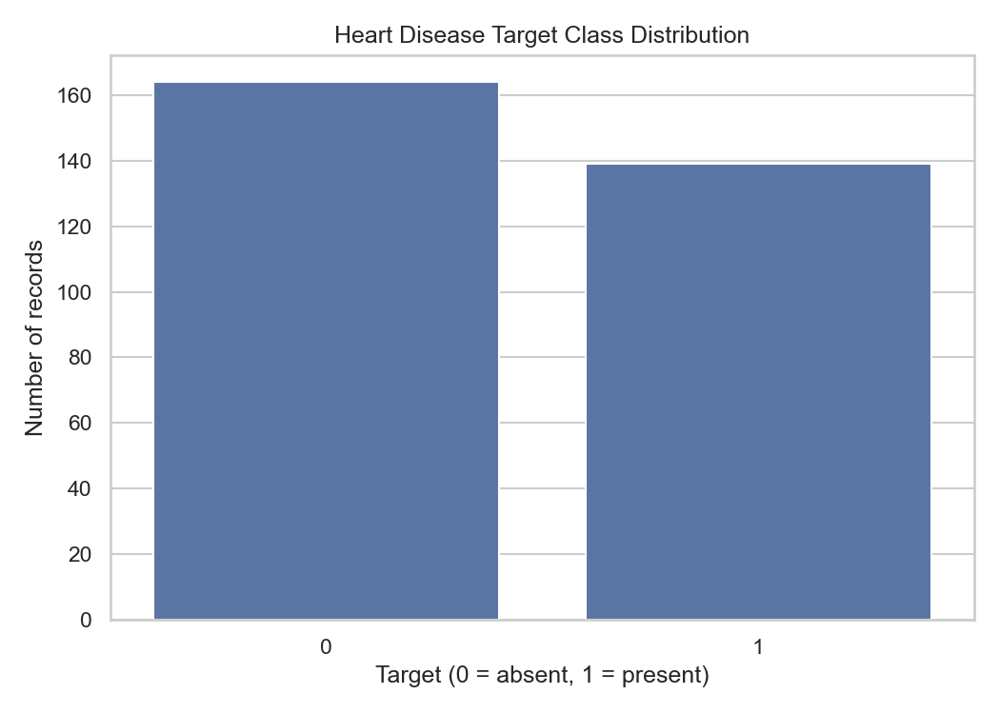

#### Feature Distributions

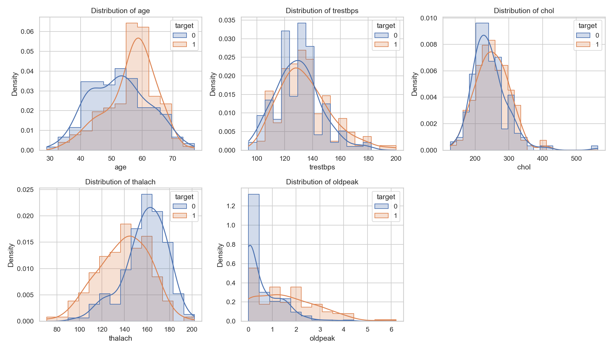

#### Correlation Heatmap

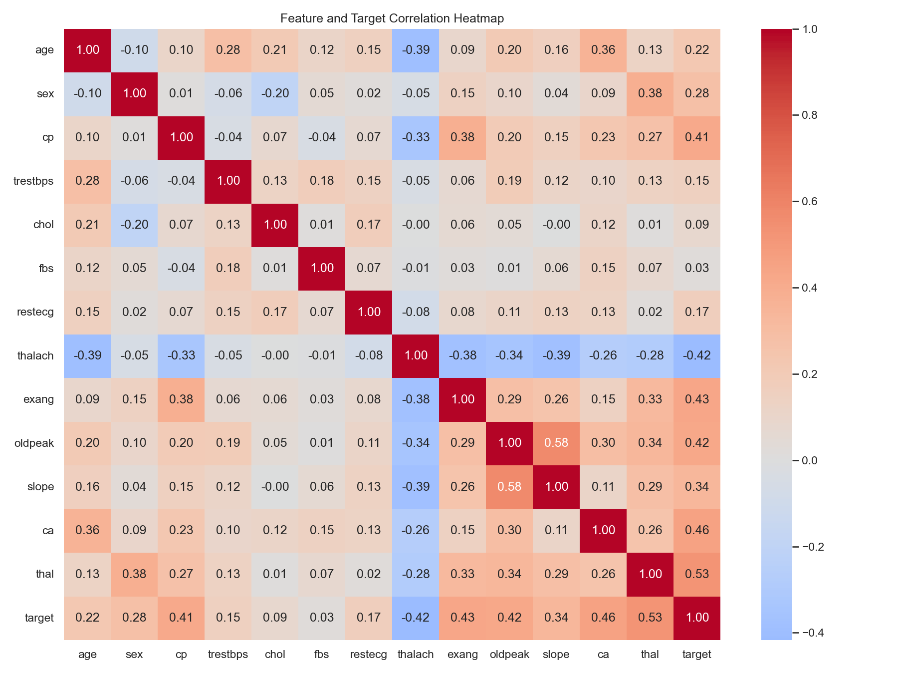

#### Age Distribution by Target

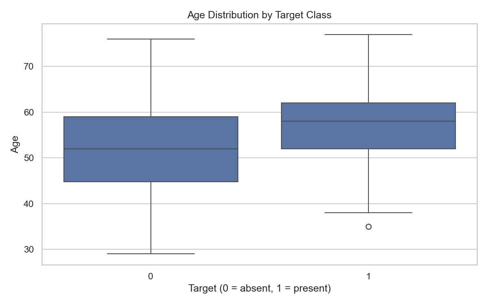

#### Missing Values

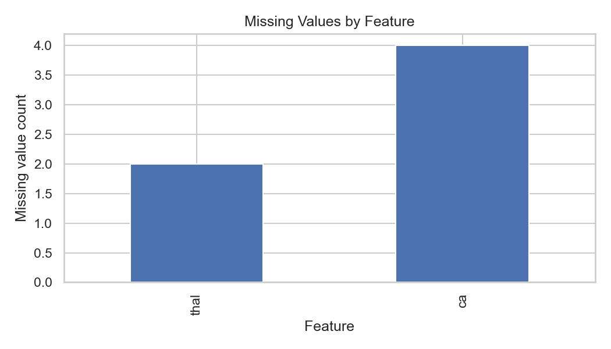

### 2.4 Model Selection

Two classification algorithms were evaluated.

**1. Logistic Regression**

- Provides a relatively interpretable baseline for binary classification.
- Is suitable for comparison with more complex models.
- Supports probability estimates for the two classes.

**2. Random Forest**

- Combines multiple decision trees.
- Can model nonlinear relationships and feature interactions.
- Provides a useful comparison against a linear baseline.

The evaluation uses stratified five-fold cross-validation and a held-out test set. The reported metrics include accuracy, precision, recall, F1-score, and ROC-AUC.

The selected model is chosen based on mean cross-validation ROC-AUC rather than the best score on the held-out test set alone.

### 2.5 Model Evaluation Results

The recorded model results are summarized below.

| Metric | Logistic Regression — CV | Random Forest — CV |
|---|---:|---:|
| Accuracy | 0.8552 | 0.8014 |
| Precision | 0.8731 | 0.7899 |
| Recall | 0.8099 | 0.7826 |
| F1-score | 0.8365 | 0.7811 |
| ROC-AUC | **0.9025** | 0.8955 |

Held-out test results:

| Metric | Logistic Regression — Test | Random Forest — Test |
|---|---:|---:|
| Accuracy | 0.8689 | **0.9016** |
| Precision | 0.8125 | **0.8438** |
| Recall | 0.9286 | **0.9643** |
| F1-score | 0.8667 | **0.9000** |
| ROC-AUC | **0.9665** | 0.9502 |

**Selected model: Logistic Regression.**

Its mean cross-validation ROC-AUC of **0.9025** is higher than Random Forest's **0.8955**, so Logistic Regression is selected under the project's cross-validation ROC-AUC selection rule.

Random Forest performs better on several metrics on this particular test split. This difference is reported transparently: model selection is based on cross-validation ROC-AUC, not on selecting whichever model has the highest individual test-set scores.

The dataset is relatively small, so these results may vary with different splits and should not be interpreted as evidence of clinical validity.

---

## 3. Experiment Tracking Summary

### 3.1 MLflow Integration

MLflow is used to track model experiments and support comparison of candidate models.

**Experiment name:** `heart-disease-classification`

The training workflow evaluates Logistic Regression and Random Forest and records experiment information such as model parameters, evaluation metrics, and available artifacts.

### 3.2 Tracked Outputs

| Output | Purpose |
|---|---|
| Model parameters | Record the configuration used for an experiment |
| Cross-validation metrics | Compare models across validation folds |
| Test metrics | Evaluate model performance on the held-out test set |
| Model comparison results | Preserve the evaluation summary in `reports/model_results.json` |
| EDA figures | Provide visual evidence of data analysis |
| Serialized model | Preserve the selected model in `artifacts/heart_disease_model.joblib` |

### 3.3 How to Inspect Experiments

Start the local MLflow interface:

```bash
mlflow ui --backend-store-uri ./mlruns --host 127.0.0.1 --port 5000
```

Then open:

`http://127.0.0.1:5000`

Select `heart-disease-classification` and inspect the actual recorded runs, parameters, metrics, and artifacts.

The MLflow interface provides a convenient way to compare the experiments without relying only on console output.

---

## 4. Architecture Diagram

The following diagram summarizes the project's data, training, tracking, CI/CD, serving, and deployment workflow.

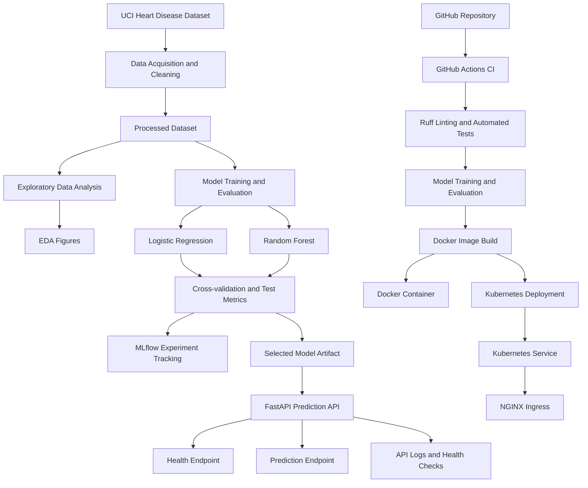

### Architecture Components

1. **Data acquisition:** Retrieves and prepares the source dataset.
2. **EDA:** Generates visualizations for class balance, feature distributions, correlations, age distribution, and missing values.
3. **Model development:** Trains and compares Logistic Regression and Random Forest.
4. **Experiment tracking:** Records experiment information using MLflow.
5. **Model packaging:** Saves the selected model as a reusable joblib artifact.
6. **API serving:** Exposes `/health` and `/predict` endpoints through FastAPI.
7. **CI/CD:** Uses GitHub Actions for linting, tests, model training, and Docker image building.
8. **Deployment:** Runs the API in Docker and Kubernetes.
9. **Operational verification:** Uses health checks and API logs to verify basic service behavior.

---

## 5. CI/CD and Deployment Workflow Screenshots

### 5.1 GitHub Actions CI/CD

The GitHub Actions workflow is defined in:

`.github/workflows/ci.yml`

The workflow is triggered by pushes and pull requests targeting the `main` branch.

The pipeline includes:

1. Repository checkout.
2. Python environment setup.
3. Dependency installation.
4. Ruff linting.
5. Automated testing.
6. Model training and evaluation.
7. Docker image build.
8. Upload of selected training and test artifacts.

The recorded GitHub Actions workflow completed successfully.

**Workflow link:**  
https://github.com/2025ae05586-kanthi/heart-disease-mlops/actions

**Screenshot:** A GitHub Actions run summary showing the workflow and its steps completed successfully.
- `screenshots/04_github_actions_ci.png`

#### GitHub Actions Screenshot

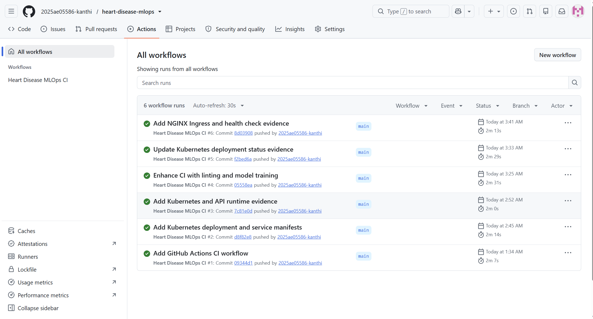

### 5.2 Docker Build and API Verification

The Docker image packages the FastAPI application and the serialized model artifact.

The API provides:

- `/health` — reports whether the service and model are ready.
- `/predict` — accepts feature values and returns the predicted class, class probabilities, and an educational-use disclaimer.

Evidence files in the repository:

- `screenshots/01_docker_build.png`
- `screenshots/02_container_running_health_check.png`
- `screenshots/03_prediction.png`
- `reports/evidence/docker-api-logs.txt`

#### Docker Image Build

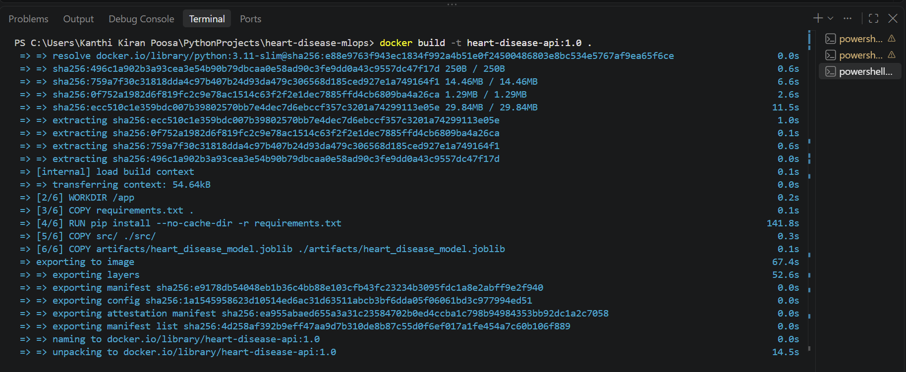

#### Running Container and Health Check

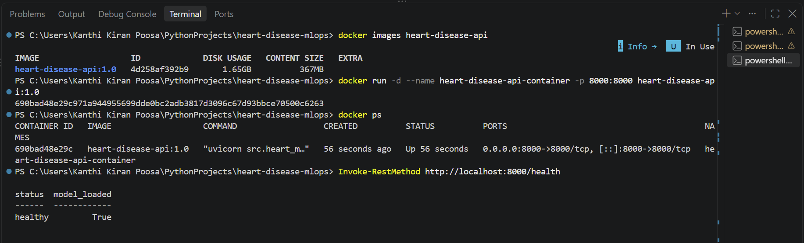

#### Prediction Response

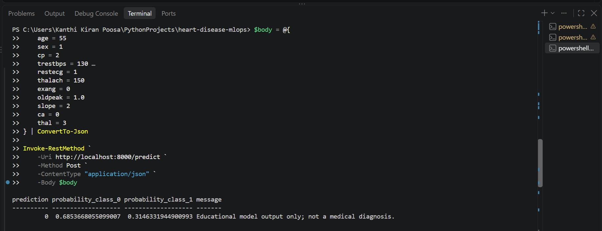

These screenshots should demonstrate that the image builds, the container starts, the health endpoint responds, and the prediction endpoint returns a response for a valid request.

### 5.3 Kubernetes Deployment

The Kubernetes configuration is maintained under:

`deployment/kubernetes/`

| Manifest | Purpose |
|---|---|
| `deployment.yaml` | Deploys the API pod and configures health probes and resource settings |
| `service.yaml` | Exposes the application through a NodePort service |
| `ingress.yaml` | Configures NGINX Ingress routing for `heart-disease.local` |

The recorded deployment status showed one ready application pod and a Kubernetes Service exposing port `8000` through NodePort `30080`.

The Ingress health check returned HTTP 200 from inside the VM/Minikube environment.

Evidence files include:

- `reports/evidence/kubernetes-status.txt`
- `reports/evidence/ingress-status.txt`
- `reports/evidence/ingress-health-check.txt`

**Important deployment limitation:** The Ingress was verified within the VM/Minikube environment. This does not establish public internet accessibility, and no public API URL is claimed.

Screenshots:

- `screenshots/05_kubernetes_resources.png`
- `screenshots/06_ingress_health_check.png`

Only retain the Markdown image references above after confirming the corresponding screenshot files exist and have been committed. If your actual filenames differ, update the paths accordingly.

### 5.4 Monitoring and Logging

The implementation includes API request logs and health checks to support basic operational verification.

The recorded evidence includes:

`reports/evidence/docker-api-logs.txt`

A Prometheus/Grafana monitoring dashboard has not been verified as part of this implementation. The project therefore reports request logging and health checks as the implemented operational evidence, rather than claiming a dashboard that is not present.

---

## 6. Link to Code Repository

**GitHub Repository:**  
https://github.com/2025ae05586-kanthi/heart-disease-mlops

The repository contains the application source code, tests, CI workflow, Docker configuration, Kubernetes manifests, model artifact, evaluation summary, and supporting evidence.

### Important Files and Directories

| Component | Path |
|---|---|
| Data acquisition and preparation | `src/heart_ml/data.py` |
| EDA and figure generation | `src/heart_ml/eda.py` |
| Training and experiment tracking | `src/heart_ml/train.py` |
| Prediction logic | `src/heart_ml/predict.py` |
| FastAPI application | `src/heart_ml/api.py` |
| Automated tests | `tests/` |
| Dependencies | `requirements.txt` |
| CI/CD workflow | `.github/workflows/ci.yml` |
| Docker image definition | `Dockerfile` |
| Docker build exclusions | `.dockerignore` |
| Kubernetes manifests | `deployment/kubernetes/` |
| Selected model artifact | `artifacts/heart_disease_model.joblib` |
| Evaluation results | `reports/model_results.json` |
| EDA visualizations | `reports/figures/` |
| Deployment evidence | `reports/evidence/` |
| Screenshots | `screenshots/` |

Evaluators can clone the repository, follow the setup instructions, inspect the training and prediction code, run the tests, review the CI/CD workflow, and examine the deployment evidence.

---

## 7. Kubernetes Deployment and NGINX Ingress

This project can be deployed locally to Kubernetes using Minikube. The Kubernetes Deployment manages the API pod, a NodePort Service exposes it, and an NGINX Ingress routes HTTP requests to the Service.

### 7.1 Prerequisites

Install and verify the following tools on the Linux VM:

- Docker
- Minikube
- `kubectl` (or use `minikube kubectl --`)
- Git

Check the installed versions:

```bash
docker --version
minikube version
minikube kubectl -- get nodes
```

### 7.2 Start the Minikube cluster

Start Minikube using the Docker driver:

```bash
minikube start --driver=docker --cpus=2 --memory=4096
```

Verify that the cluster is running and the node is ready:

```bash
minikube status
minikube kubectl -- get nodes
```

The node status should be `Ready`.

### 7.3 Build and load the Docker image

From the project root directory, build the API image:

```bash
docker build -t heart-disease-api:1.0 .
```

Load the image into Minikube so that Kubernetes can use the locally built image without pulling it from a registry:

```bash
minikube image load heart-disease-api:1.0
```

### 7.4 Deploy the application to Kubernetes

Apply the Deployment and Service manifests:

```bash
minikube kubectl -- apply -f deployment/kubernetes/deployment.yaml
minikube kubectl -- apply -f deployment/kubernetes/service.yaml
```

Check the Deployment, pods, and Service:

```bash
minikube kubectl -- get deployments
minikube kubectl -- get pods -o wide
minikube kubectl -- get services
```

Wait for the Deployment to become available:

```bash
minikube kubectl -- rollout status deployment/heart-disease-api
```

Expected result: the Deployment becomes available and its pod reaches `Running` with `1/1` containers ready.

### 7.5 Test the API through Kubernetes

The Service is configured as a NodePort Service on port `30080`. Start a local port-forward:

```bash
minikube kubectl -- port-forward service/heart-disease-api 8001:8000
```

Keep this terminal open. In a second terminal, test the health endpoint:

```bash
curl http://127.0.0.1:8001/health
```

Expected response:

```json
{
  "status": "healthy",
  "model_loaded": true
}
```

Open the API documentation in a browser if the port-forward is active:

```text
http://127.0.0.1:8001/docs
```

### 7.6 Enable the NGINX Ingress controller

Enable the Minikube Ingress addon:

```bash
minikube addons enable ingress
```

Check that the Ingress controller is running:

```bash
minikube kubectl -- get pods -n ingress-nginx
minikube kubectl -- get ingressclass
```

Wait until the NGINX Ingress controller pod is ready before proceeding.

### 7.7 Apply the Ingress manifest

Create the Ingress resource using the existing project manifest:

```bash
minikube kubectl -- apply -f deployment/kubernetes/ingress.yaml
```

Verify the resource:

```bash
minikube kubectl -- get ingress
minikube kubectl -- describe ingress heart-disease-api-ingress
```

The Ingress routes requests for the host `heart-disease.local` to the `heart-disease-api` Service on port `8000`.

### 7.8 Test the Ingress endpoint

Find the Minikube IP:

```bash
minikube ip
```

For the current VM setup, the Minikube IP is `192.168.49.2`. If it differs in your environment, use the IP returned by the command.

From the Linux VM, test the Ingress health endpoint:

```bash
curl -i --resolve heart-disease.local:80:192.168.49.2 \
  http://heart-disease.local/health
```

Expected result: HTTP `200 OK` and a healthy API response.

To test the prediction endpoint through Ingress, use:

```bash
curl -X POST \
  http://heart-disease.local/predict \
  -H "Host: heart-disease.local" \
  -H "Content-Type: application/json" \
  -d '{
    "age": 63,
    "sex": 1,
    "cp": 3,
    "trestbps": 145,
    "chol": 233,
    "fbs": 1,
    "restecg": 0,
    "thalach": 150,
    "exang": 0,
    "oldpeak": 2.3,
    "slope": 0,
    "ca": 0,
    "thal": 1
  }'
```

The response should contain the predicted class, class probabilities, and the educational-use disclaimer.

**Note:** The `--resolve` option maps the hostname to the specified IP for that individual `curl` request. It does not make the service publicly accessible. The Ingress endpoint has been verified from within the VM; public internet access has not been configured or verified.

### 7.9 Useful Kubernetes diagnostic commands

Use these commands if the application does not start or the endpoint fails:

```bash
minikube kubectl -- get all
minikube kubectl -- get events --sort-by=.lastTimestamp
minikube kubectl -- logs deployment/heart-disease-api
minikube kubectl -- describe deployment heart-disease-api
minikube kubectl -- get pods -n ingress-nginx
minikube kubectl -- logs -n ingress-nginx deployment/ingress-nginx-controller
```

If the image was rebuilt, reload it into Minikube and restart the Deployment:

```bash
docker build -t heart-disease-api:1.0 .
minikube image load heart-disease-api:1.0
minikube kubectl -- rollout restart deployment/heart-disease-api
minikube kubectl -- rollout status deployment/heart-disease-api
```

### 7.10 Evidence and screenshots

Captured and included the following screenshots in the project report:

1. Minikube node in `Ready` state.
2. Kubernetes Deployment and pod in `Running` state.
3. Kubernetes Service and Ingress resources.
4. Successful Ingress `/health` response with HTTP `200 OK`.
5. Successful `/predict` response through the Ingress endpoint.

Screenshots:

- `screenshots/07_ingress_predict_success.png`


#### Ingress Prediction Screenshot

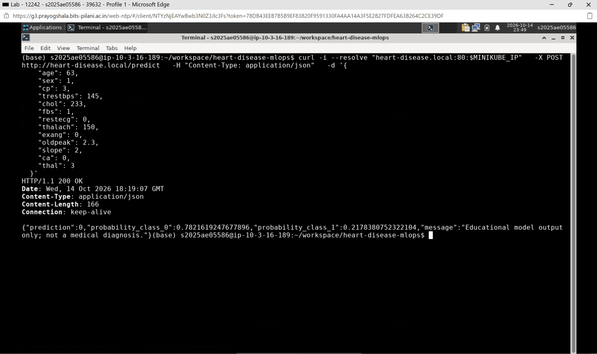

### 7.11 Stop the local cluster

When Kubernetes testing is complete:

```bash
minikube stop
```

To delete the local Minikube cluster entirely:

```bash
minikube delete
```

Use `minikube stop` when you want to preserve the cluster for later demonstrations. The delete command removes the cluster and its local Kubernetes resources.

---

## 8. API Monitoring and Dashboard

### Overview

The project includes a local API monitoring solution using FastAPI request logging and a Streamlit dashboard. It records incoming HTTP requests and displays operational metrics to help evaluate the behavior of the deployed prediction API.

### Monitoring Architecture

1. A client sends a request to the FastAPI service.
2. FastAPI processes the request and returns an HTTP response.
3. HTTP middleware records the request timestamp, method, endpoint, status code, response time, and success/failure indicator.
4. Monitoring records are stored as JSON Lines in `monitoring/requests.jsonl`.
5. A Streamlit dashboard reads the log file and presents the collected metrics and charts.

**Architecture flow:**

Client → FastAPI API → Request logging middleware → JSONL log file → Streamlit dashboard

### Technologies Used

- **FastAPI:** Serves the prediction API and captures HTTP request information.
- **Docker:** Runs the API in a container.
- **Python logging implementation:** Writes structured request records in JSON Lines format.
- **Pandas:** Loads and processes monitoring records.
- **Streamlit:** Provides an interactive monitoring dashboard.

### Metrics Captured

| Metric | Description |
|---|---|
| Total requests | Number of recorded HTTP requests |
| Successful requests | Requests with HTTP status codes from 200 to 399 |
| Failed requests | Requests with HTTP status codes outside that success range |
| Success rate | Successful requests divided by total requests |
| Average latency | Mean recorded request processing time in milliseconds |
| Maximum latency | Highest recorded request processing time |
| HTTP status distribution | Distribution of responses by HTTP status code |
| Requests by endpoint | Request counts grouped by API endpoint |

### Dashboard Features

The Streamlit dashboard provides:

- Summary metrics for request volume, success rate, failures, and latency.
- HTTP status code distribution chart.
- Request counts by endpoint.
- API response-time chart over time.
- Recent request history with timestamps, methods, endpoints, status codes, and latency.
- Endpoint filters to inspect selected API routes.
- CSV export of the displayed request history.
- Manual refresh and an optional control to clear local monitoring logs.

### Running the Dashboard Locally

Activate the project's virtual environment and install dependencies:

```powershell
.\.venv\Scripts\Activate.ps1
python -m pip install -r requirements.txt
```

Start the Streamlit dashboard from the project root:

```powershell
python -m streamlit run dashboard.py
```

Open the local dashboard at:

`http://localhost:8501`

The dashboard reads monitoring records from:

`monitoring/requests.jsonl`

### API Verification

Check the API health endpoint:

```powershell
Invoke-RestMethod http://localhost:8000/health
```

Test a prediction using the API documentation at:

`http://localhost:8000/docs`

Requests received by the API are recorded by the monitoring middleware, including HTTP validation errors and requests to unknown endpoints.

### Monitoring Screenshots

The following screenshots provide evidence of the local monitoring implementation:

**Dashboard metrics and charts**

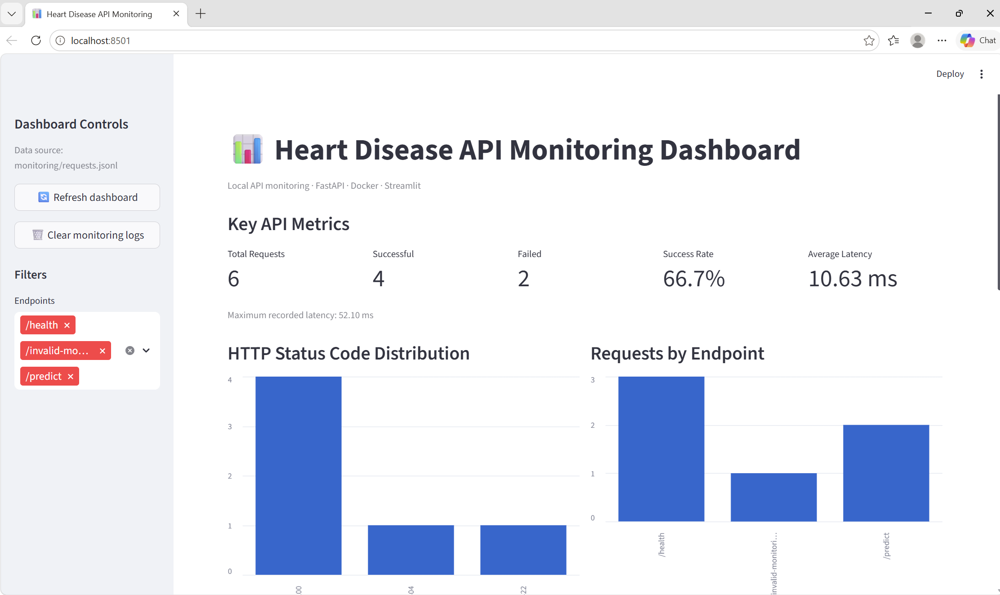

**Response-time chart and request logs**

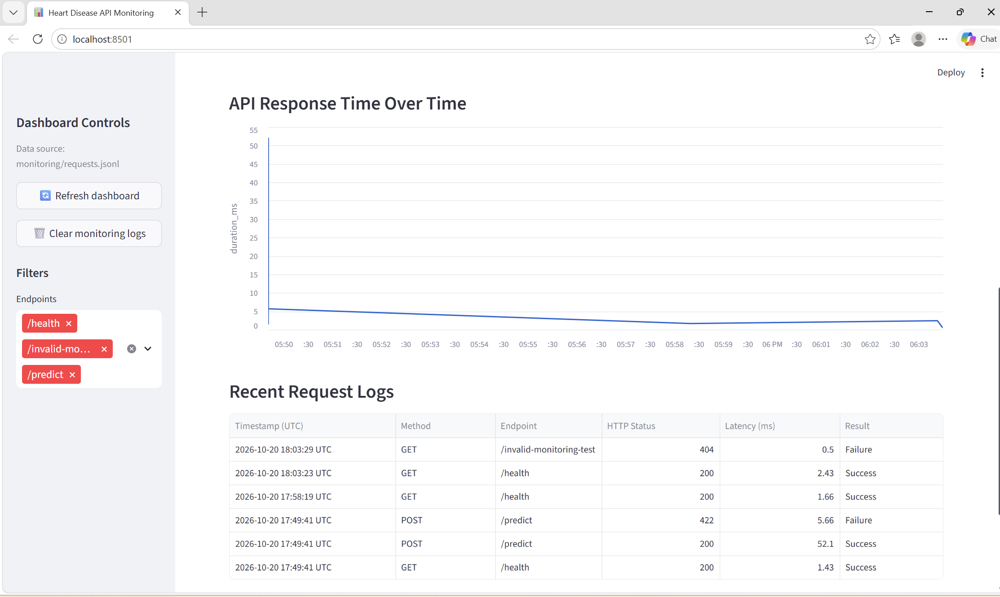

### Limitations and Scope

- The dashboard uses manual refresh; it does not automatically refresh at a fixed interval.
- The dashboard reads the local monitoring log file. It does not automatically collect metrics from the Kubernetes deployment on the VM.
- The recorded request metrics describe API operations and latency; they are not model-accuracy metrics.
- The log file is generated at runtime and is excluded from Git. Screenshots and source code are retained as project evidence.
- This project is an educational machine-learning demonstration, not a medical diagnostic system.

